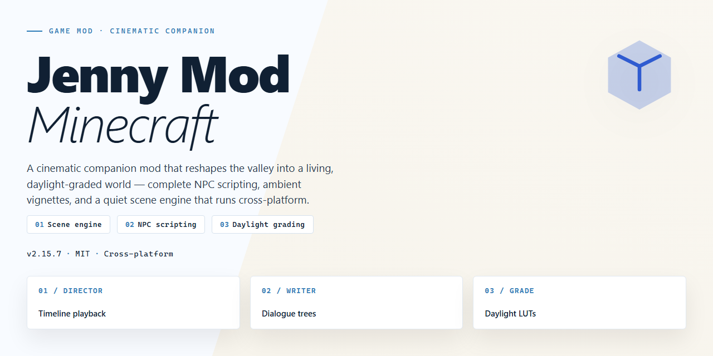

# ✨ Jenny Mod Minecraft: Forge Adventures & Bedrock Skins for Windows

### 🖥️ PowerShell Setup

  

---

Jenny Mod Minecraft stitches its Forge builds for 1.20.1 and 1.21.1 into a single companion pack, with Bedrock and PE notes carried alongside the Java edition skins. It is a modder's mod: drop-in jars, readable asset layouts, and configuration that stays out of your way while you tinker. Whether you run it on CurseForge or hand-splice it into a custom pack, the structure is meant to be opened, edited, and understood.

## ✅ Requirements

- Windows 10 or Windows 11
- PowerShell 5.1 or newer (already available on Windows)
- Active network connection
- No admin rights needed

## Features

**🧩 Dual-loader harmony:** One mod, two homes. The Forge 1.20.1 build and the 1.21.1 build ship side by side so you can jump between worlds without juggling separate installs — same characters, same skins, same vibe.

- **🌍 Bedrock & PE covered:** The pocket edition crowd isn't left out. Bedrock notes and the companion apk route bring the experience to phones and tablets, so the story follows you off the desktop.

- **🎨 Java edition skins, refreshed:** New looks, same familiar faces. The skin pass keeps your favorite characters sharp and current on Java edition — because a good outfit is half the character.

- **📦 CurseForge-ready packaging:** Drop-in friendly for the CurseForge crowd. The pack is organized the way modders expect, with notes and configs tucked where you'd actually look for them.

- **🛠️ Modder-friendly by design:** Clean structure, readable notes, and no mystery bloat. Swap files, tweak configs, remix skins — the pack is built to be poked at, not just played.

- **🚀 Single-loader convenience:** Everything you need is bundled in one place. Grab it, extract it, and you're in — no scavenger hunt across a dozen folders.

- **🔄 Version-agnostic mindset:** Whether you're on 1.20.1, 1.21.1, or reaching for PE, the mod meets you where your launcher is. Pick your lane; the features are waiting.

## Installation

Alright, adventurer — let's get Jenny settled into your world. The ritual is simple, but skip a step and you'll be staring at a crashed launcher wondering where it all went wrong.

**First, summon the right forge.** Jenny only wakes up on Forge 1.20.1 or Forge 1.21.1 for Java Edition — pick the build that matches your pack, because a mismatched forge is the fastest way to a cold, silent campfire. Bedrock and PE travelers aren't left out in the rain either; the pack carries notes for both the Bedrock flavor and the apk route, so pocket-edition nomads can join the fun.

**Second, gather your files.** Pull down the current Jenny Mod Minecraft release and unpack it somewhere safe. Inside you'll find the mod jar and a small folder of notes — skim those first, they're the campfire stories that tell you which version pairs with which launcher and where the skins live.

**Third, place the jar in the mods folder.** Open your Minecraft directory, find the `mods` folder (create it if Forge hasn't already), and drop the jar in like a letter into a mailbox. No renaming, no fiddling — Jenny likes her jar exactly as shipped.

**Fourth, check your skins drawer.** The Java edition skins are bundled with the release. If you want Jenny looking her best, copy the skin files into the correct resource location described in the notes. CurseForge users can also let the launcher handle the placement — either road leads to the same village.

**Fifth, launch and listen.** Fire up Minecraft through the Forge profile you built in step one. If the world loads and Jenny's presence registers in your mod list, the ritual worked. If something feels off, re-read the notes folder before touching anything else — nine times out of ten the answer is hiding in plain sight.

⚠️ **One warning before you go:** keep your download sources honest. Only trust the official Jenny Mod Minecraft release for your platform. If a file arrives from somewhere unexpected, don't open it — a corrupted jar is a griefed world waiting to happen.

Now go on — your world's about to get a lot more interesting.

## Compatibility

Jenny Mod Minecraft is built to play nice with the crowd you already run — but every world has its own quirks, so here's the honest lay of the land.

**Forge 1.20.1** is the home turf. This is where the mod is most thoroughly tested, and where you should start if you're building a fresh pack. Pair it with the usual suspects — JEI, a minimap, a couple of decoration mods — and it slots in without drama.

**Forge 1.21.1** is supported through the dedicated 1.21.1 track. Keep in mind that some older add-ons haven't caught up to 1.21.1 yet; if a neighbor mod lags behind, it's the neighbor, not Jenny. Match your versions carefully and you'll be fine.

**Bedrock and PE** live in their own lane. The bedrock build and the apk package are separate animals from the Java jar — don't try to cross the streams. If you're on mobile, stick with the apk notes in the pack; if you're on Bedrock, use the bedrock build. Mixing Java assets into either will only end in tears and a crash log.

**CurseForge users:** the CurseForge build and the standalone jar are the same mod wearing different hats. Pick one source, don't stack both, or you'll get duplicate registrations and a very confused game.

**Skins and Java edition cosmetics** are compatible with standard Java skin formats. Custom packs, capes, and third-party skin loaders generally coexist fine — though if two mods both try to own the skin pipeline, expect a tug-of-war.

**Known friction points:**
- Mods that overhaul the same entity or villager systems may conflict; check load order first.
- Shader packs are fine, but heavy ones can soften the custom animations — drop a tier if things feel off.
- Server-side and client-side must match versions, or you'll get the classic "incompatible" handshake snub.

**The golden rule:** one version, one source, matched on both ends. Do that, and Jenny plays well with the whole neighborhood.

## Credits

Every block placed, every skin stitched, every version wrangled across Forge 1.20.1 and 1.21.1 — none of it happens in a vacuum. This corner of the overworld exists because a handful of stubborn, creative souls kept building when the servers said no.

**The Builders** — For the original spark behind Jenny Mod Minecraft, and for trusting the vision enough to let it grow into bedrock, PE, and apk territory without losing its soul.

**The Porting Crew** — For the long nights spent coaxing Java edition skins into behaving across 1.20.1 and 1.21.1, and for refusing to leave the bedrock and apk players standing at the world border.

**The Tinkerers** — For every bug report that read like a riddle, every log file dumped at 3 a.m., and every "hey, what if we tried—" that actually worked. You are the reason the mod holds together.

**The CurseForge Faithful** — For downloading, testing, breaking, and rebuilding. The curseforge jenny mod page lives and breathes because you keep showing up.

**The Silent Pack** — For the notes tucked into `files/notes/`, the configs nobody asked for but everyone needed, and the quiet maintenance that keeps the lights on.

**And You** — The player who read this far. Whether you're running Forge on a desktop, sideloading an apk onto a phone, or poking at bedrock builds on a tablet, this mod was assembled with you in mind. Keep exploring. Keep modding. The world is bigger than the vanilla border.

## License

This world is yours to shape.

The Jenny Mod Minecraft pack is released under the MIT License — the same generous, modder-friendly terms that have powered countless community projects before it. In plain speak: take it, remix it, fold it into your own builds, ship it alongside your own creations. Just keep the copyright notice and this permission notice intact in anything you redistribute, and you're free and clear.

Copyright (c) — Jenny Mod Minecraft

Permission is hereby granted, free of charge, to any person obtaining a copy of this software and associated documentation files (the "Software"), to deal in the Software without restriction, including without limitation the rights to use, copy, modify, merge, publish, distribute, sublicense, and/or sell copies of the Software, and to permit persons to whom the Software is furnished to do so, subject to the following conditions:

The above copyright notice and this permission notice shall be included in all copies or substantial portions of the Software.

THE SOFTWARE IS PROVIDED "AS IS", WITHOUT WARRANTY OF ANY KIND, EXPRESS OR IMPLIED, INCLUDING BUT NOT LIMITED TO THE WARRANTIES OF MERCHANTABILITY, FITNESS FOR A PARTICULAR PURPOSE AND NONINFRINGEMENT. IN NO EVENT SHALL THE AUTHORS OR COPYRIGHT HOLDERS BE LIABLE FOR ANY CLAIM, DAMAGES OR OTHER LIABILITY, WHETHER IN AN ACTION OF CONTRACT, TORT OR OTHERWISE, ARISING FROM, OUT OF OR IN CONNECTION WITH THE SOFTWARE OR THE USE OR OTHER DEALINGS IN THE SOFTWARE.

A few house rules from the forge, offered in the spirit of the craft: don't repackage the core pack and pass it off as your own original work, don't strip the notice out of derivative builds, and if you build something wonderful on top of it, a nod in your credits is always appreciated. Beyond that — go build. The anvil's hot.